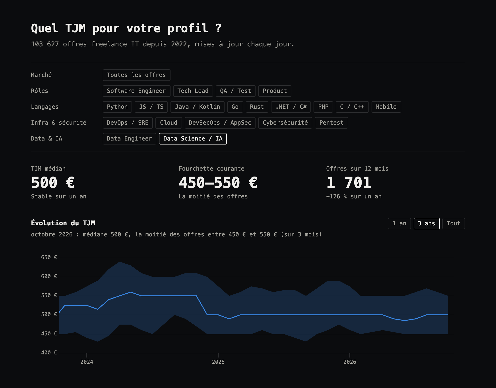
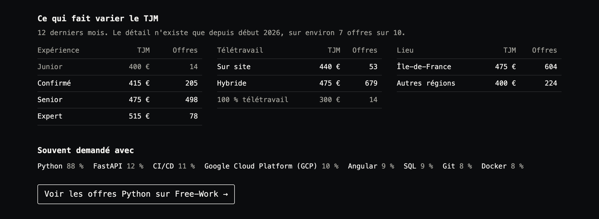
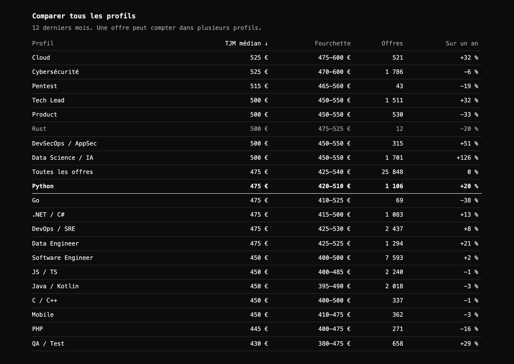
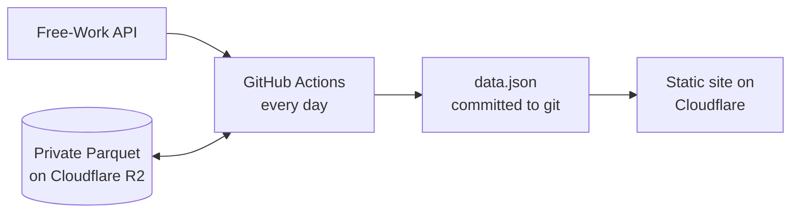

# TJM freelance

**What should an IT freelancer in France charge, and is demand rising?**

Daily rates (TJM) and demand for 30 tech profiles, calculated from over 100,000 offers since 2022 and rebuilt every day as open data.

**[freelance.shellbear.me](https://freelance.shellbear.me)** · [`data.json`](https://freelance.shellbear.me/data.json) · [Data history](https://github.com/shellbear/freelance/commits/main/public/data.json)

[](https://github.com/shellbear/freelance/actions/workflows/daily-stats.yml)



## What it answers

- **What can I charge?** The median rate and usual range for your stack or role, and how they have moved over time.
- **Is demand rising?** Offers per month, and the change over a year.
- **What moves my rate?** Experience, remote work and location, plus the skills most often requested alongside yours.
- **How do profiles compare?** Every profile side by side, sortable by rate or demand.
- **Which profiles are growing?** [`/tendances`](https://freelance.shellbear.me/tendances) ranks profiles by their change in offers over a year, with their median rate, then the technologies and specialties within them (Databricks, Vue, LLM…), and follows remote work month by month. Each chart can be copied as an image or downloaded as CSV.





## Open data

Everything on the page comes from one file, [`public/data.json`](public/data.json), updated daily under [CC BY 4.0](https://creativecommons.org/licenses/by/4.0/). Each update is a commit, so `git log -p public/data.json` gives you the full history.

```sh
curl -s https://freelance.shellbear.me/data.json \
  | jq '.categories[] | select(.id == "go") | {n, rate}'
```

Each entry in `categories` contains:

| Field                              | Meaning                                                                                                        |
| ---------------------------------- | -------------------------------------------------------------------------------------------------------------- |
| `id`, `label`, `group`             | The profile                                                                                                    |
| `n`, `nPrior`                      | Offers in the last 12 months and the 12 before that                                                            |
| `rate`, `ratePrior`                | 25th, 50th and 75th percentile for those periods                                                               |
| `volume`                           | Offers per month, aligned with the top-level `months`                                                          |
| `p25`, `p50`, `p75`                | Rate per month, over a trailing 3-month window                                                                 |
| `experience`, `remote`, `location` | Rate and offers per group, over the last 12 months                                                             |
| `skills`                           | Most requested skills, as a share of tagged offers                                                             |
| `subgroups`                        | Offers and median rate per technology or specialty within the profile, in both periods; each offer counts once |

The top-level `remoteByMonth` is aligned with `months` and gives, for each month, the offers stating a remote mode (`n`) and how many are on-site (`none`), hybrid (`partial`) or fully remote (`full`). It is `null` before 2026, when Free-Work did not report the mode, and for months with fewer than 100 such offers.

Please credit this project and [Free-Work](https://www.free-work.com/fr/tech-it/jobs), the source of the offers. This project is independent and not affiliated with Free-Work.

## How the numbers are made

- **Advertised rates:** these are the rates shown in offers, not what is actually invoiced. When an offer gives a range, its middle is used.
- **Reposts:** an offer republished by the same company within 30 days counts once. Without this, a single reposted offer can dominate a small profile.
- **Profiles:** offers are sorted from their title, with Free-Work's job label as a fallback. An offer can count in several profiles. The [rules](pipeline/categories.ts) and their [tests](pipeline/categories.test.ts) are public, and they can be wrong.
- **Small groups:** groups of fewer than 5 offers are not published.
- **Known gaps:** some collection days are missing, so a drop in volume isn't always a drop in the market. Experience, remote and location data only exist from early 2026.

## How it works

There is no server and no public database. A daily job produces static files.



1. [`pipeline/fetch.ts`](pipeline/fetch.ts) merges the last 7 days of offers into a private Parquet file, so a failed run heals itself the next day. Descriptions are not stored.
2. [`pipeline/build.ts`](pipeline/build.ts) turns that file into aggregated statistics. Offer-level data never leaves the private file.
3. [The workflow](.github/workflows/daily-stats.yml) deploys the site and commits `data.json`. If the job ever stops, the page shows a warning once the data is more than 3 days old.

Built with [Bun](https://bun.com), [DuckDB](https://duckdb.org) and [uPlot](https://github.com/leeoniya/uPlot), with no framework. The page weighs about 40 KB.

## Development

```sh
bun install
bun run dev      # the site with the committed data.json, on http://localhost:8787
bun run verify   # formatting, type checking and tests
```

The private offers file isn't in this repository, so `bun run fetch` and `bun run build` only work for maintainers. Improving how offers are sorted doesn't need it: add a real title to [the tests](pipeline/categories.test.ts), update [the rules](pipeline/categories.ts) and open a pull request.

## License

Code under [GPL-3.0](LICENSE). Statistics in `public/data.json` under [CC BY 4.0](https://creativecommons.org/licenses/by/4.0/).
